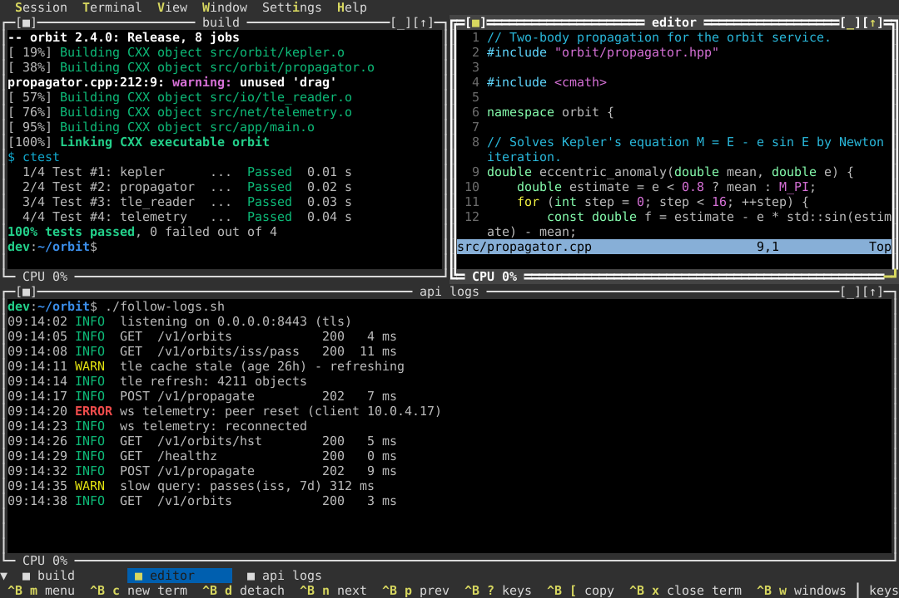
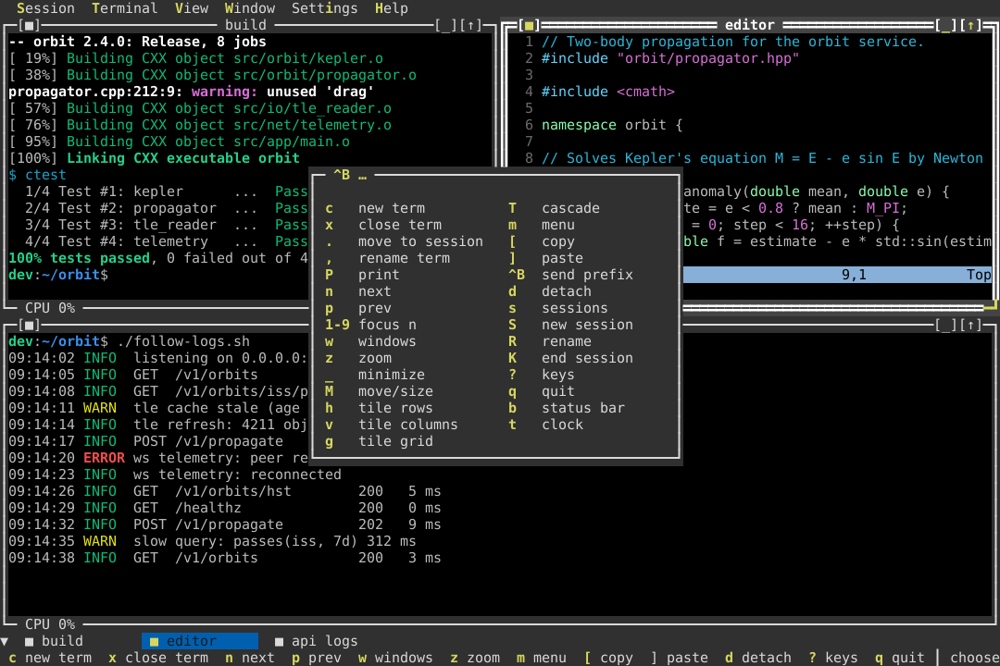
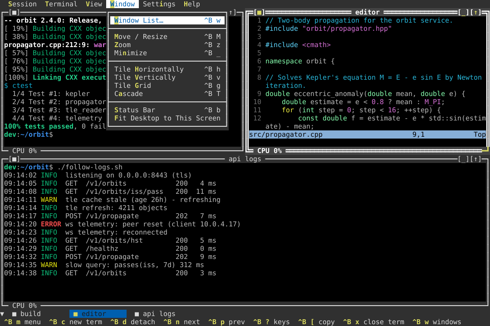
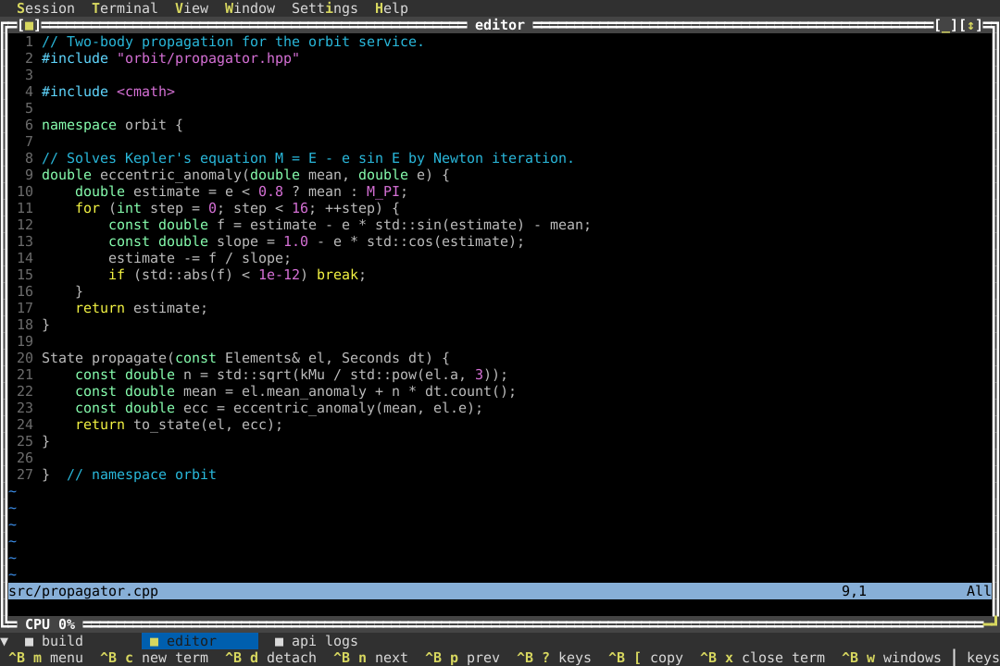
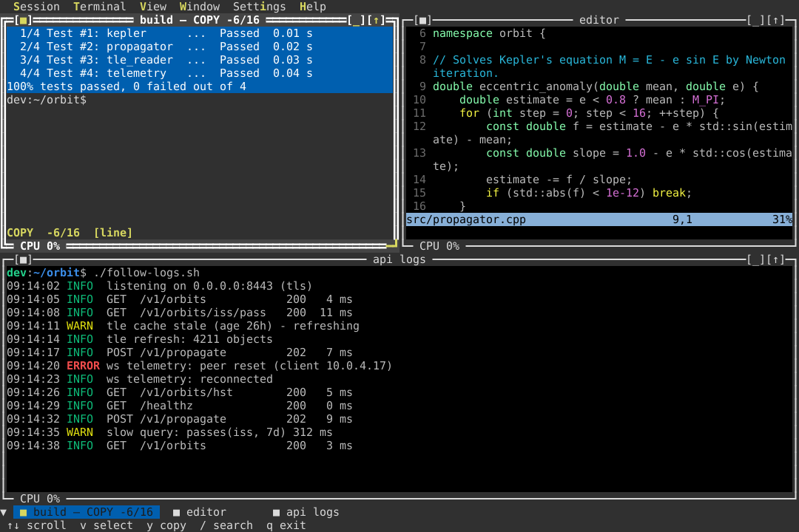
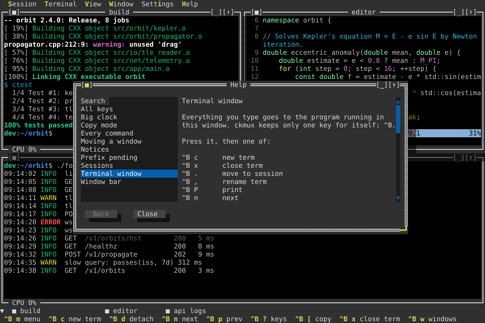
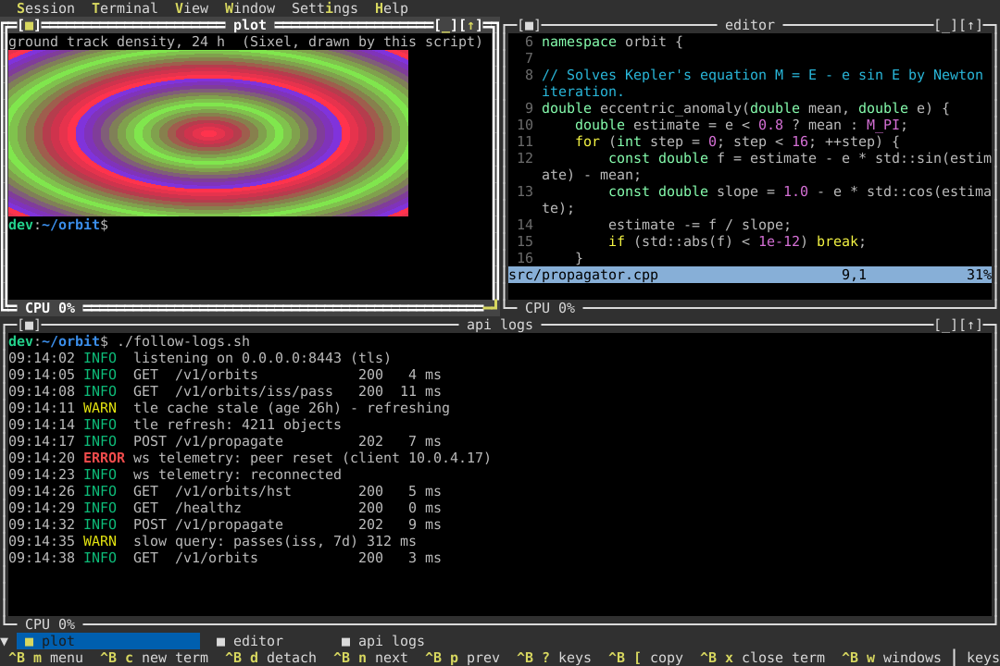
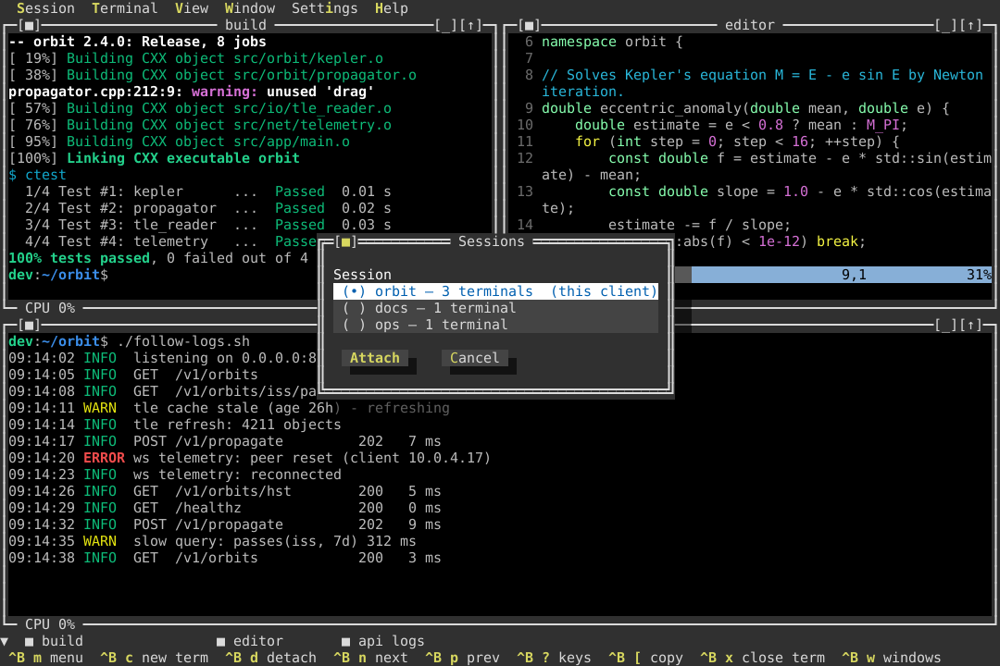
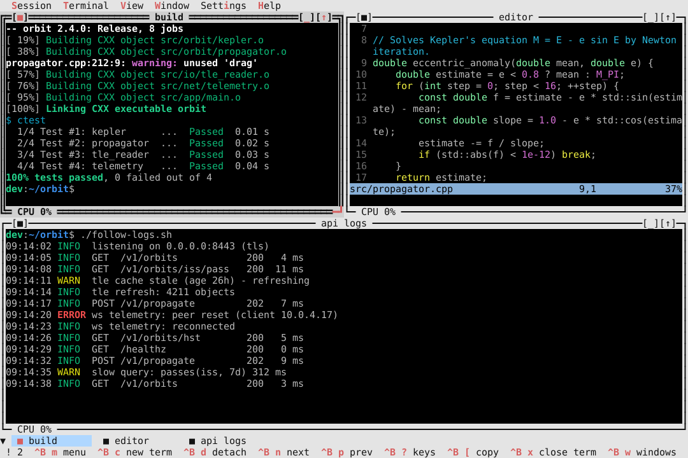
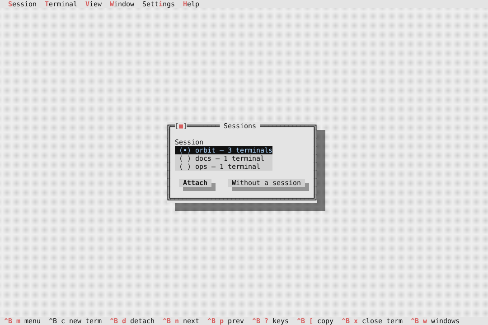

# A tour of ckmux

Every picture on this page is ckmux itself: the real program, running bash,
vim and a small demo project in a pseudo-terminal, with its screen decoded
and saved as an image. Nothing is mocked up. The keys under each picture are
the ones that produced it.

## One desktop, every program in its own window



A session is a desktop. Each terminal is a window with a title, a frame you
can drag, and an optional CPU or memory readout in its bottom edge. The
title comes from the program when it sets one (`build`, `editor` and
`api logs` here) or from you (`^B ,`). The window bar above the footer lists
every terminal, and the focused one has the double frame.

This desktop is three `^B c` and one `^B g` (tile as a grid). `^B h` and
`^B v` tile in rows or columns, `^B T` cascades, and dragging a title or an
edge with the mouse moves or resizes a window.

## The keys are always on screen



**Ctrl+B** is the prefix, the one key ckmux keeps for itself. Press it and a
popup lists everything that can follow, while the footer switches to the
same choices. You never have to remember a binding to find it; once you know
it, the popup gets out of the way as soon as you press the next key.

## Every command is in a menu



`^B m` opens the menu bar, or click it. Each item shows its shortcut, so the
menus double as a key reference. Underlined letters jump straight to an item.

## Zoom one window to the whole desktop



`^B z` zooms the focused window and `^B z` again puts it back where it was.
The other programs keep running behind it.

## Copy mode: select through scrollback



`^B [` freezes the focused terminal and lets you move through its history:
`v` selects characters, `V` lines, Ctrl+V a rectangle, and `/` or `?`
searches. Enter copies the selection to your clipboard, through the outer
terminal or a helper you choose; `^B ]` pastes it.
The [key reference](keys.md#copy-mode-and-paste) has every copy-mode key.

## Help without leaving the terminal



`^B ?` opens the key reference: every command, its key, and a short guide to
each part of the interface, searchable. It is built from the same registry
that dispatches the keys, so it always matches your configuration.

## Graphics in a window



Programs that draw Sixel pictures (plotting libraries, image viewers,
`img2sixel`) work inside ckmux when the outer terminal supports Sixel. The
picture stays in its window: it moves with the window, is clipped by
windows above it, and scrolls with the text. On a terminal without Sixel,
ckmux tells programs so, and they print their text fallback instead.

## Several sessions on one server



Keep one session per project. `ckmux new -s docs` makes one from the command
line, `^B S` from the desktop, and `^B s` switches between them. Each session
keeps its own windows and layout.

## Leave, and come back



`^B d` detaches, `^B q` quits the client, and closing the terminal or losing
an SSH connection does the same: the server keeps every program running.
Start `ckmux` again, from the same or another terminal, and you are back
where you were. This picture was taken after quitting the client and
starting a new one with the light theme: the log is still being followed
and the editor is still open.

With more than one session, the return starts at the picker:



## Make your own pictures

The screenshots are produced by `tools/screenshots/capture_screens.cpp`,
which drives the real binary with keystrokes and renders its screen with
ckVision's `scene::render_svg_snapshot`. To regenerate them after a change:

```sh
cmake -S . -B build -DCKMUX_BUILD_SCREENSHOTS=ON
cmake --build build --target ckmux_update_screenshots
```

The generator needs macOS or Linux with bash and vim. See [Building from source](building.md).
